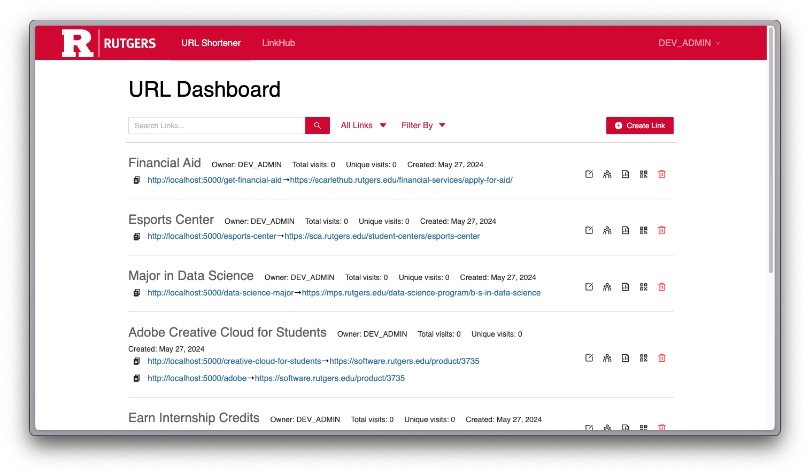

# Shrunk, the URL Shortener for Rutgers University

[Shrunk](https://go.rutgers.edu/) is an open-source full-stack application primarily made to shorten URLs for faculty and professors of Rutgers University. It is written in [Python 3.6](https://www.python.org/) and [TypeScript](https://www.typescriptlang.org/) and uses [MongoDB](https://www.mongodb.com/), [HTTPD](https://httpd.apache.org/), [React](https://react.dev/), and [Flask](https://flask.palletsprojects.com/).



## Features

- Shorten URLs with a dedicated statistics page
- Create tracking pixels
- Collaborate with multiple links under an organization
- Supports SSO (Single-sign-on)

## Build Instructions

> [!WARNING]  
> Make sure you are connected to an outlet before running Shrunk, it will drain your laptop's battery.

1. Install or update [Docker Desktop](https://docs.docker.com/desktop/) with your Docker Engine being version 27 or newer
2. Create a copy of `.env.example` and name it `development.env`
3. In `development.env`, explicitly set `FLASK_ENV=development`,
   `SHRUNK_DEV_LOGINS=1`, and `FLASK_DEBUG=true`. Set `SHRUNK_SECRET_KEY` to a
   locally generated key using the command in `.env.example`.
4. Start the Docker containers

```
docker-compose up
```

5. Start developing at `http://localhost:4343` [(click to learn more about this change)](https://stackoverflow.com/questions/72369320/why-always-something-is-running-at-port-5000-on-my-mac)

## Local Development

- We use uv as our package manager, install it [here](https://docs.astral.sh/uv/getting-started/installation/#installation-methods)
- Run `uv sync` to install the dependencies, get typing information and set up the venv


### Test your code locally

This is completely optional as GitLab CI/CD should also provide you the test results.

1. Create a copy of `.env.example` and name it `test.env`
2. Set the following values
```
SHRUNK_DB_HOST="mongodb-test"
SHRUNK_DB_PORT="27018"
SHRUNK_FLASK_TESTING=1
SHRUNK_DEV_LOGINS=1
SHRUNK_SECRET_KEY="isolated-test-session-key"
```
3. Start the Docker containers
```
docker-compose -f docker-compose.tests.yml up
```

Production startup requires `SHRUNK_DEV_LOGINS=0`, `FLASK_DEBUG=0` (or `false`),
and a unique generated `SHRUNK_SECRET_KEY` of at least 32 bytes. Generate it with
`python -c 'import secrets; print(secrets.token_hex(32))'`. For local development,
explicitly set `FLASK_ENV=development` before enabling debug or dev logins.
`SHRUNK_FLASK_TESTING=1` permits isolated test settings; never enable it in production.

## Contributing

### Formatting

We use [ruff](https://docs.astral.sh/ruff/) for our backend's formatting & linting, while using pylint & ruff for linting in the GitLab CI/CD, you can run this command to make sure your code is up to standards. If you're using Visual Studio Code, it does this automatically.

This command runs the format check (if in venv you can omit `uv run` from the commands)
```
uv run ruff format 
```
This command runs the lint check
```
uv run ruff check 
```

We also use [Prettier](https://prettier.io/) for our frontend's formatting, you can run this command to make sure your code is up to standards. If you're using Visual Studio Code, it does this automatically.

```
npx prettier --write .
```
